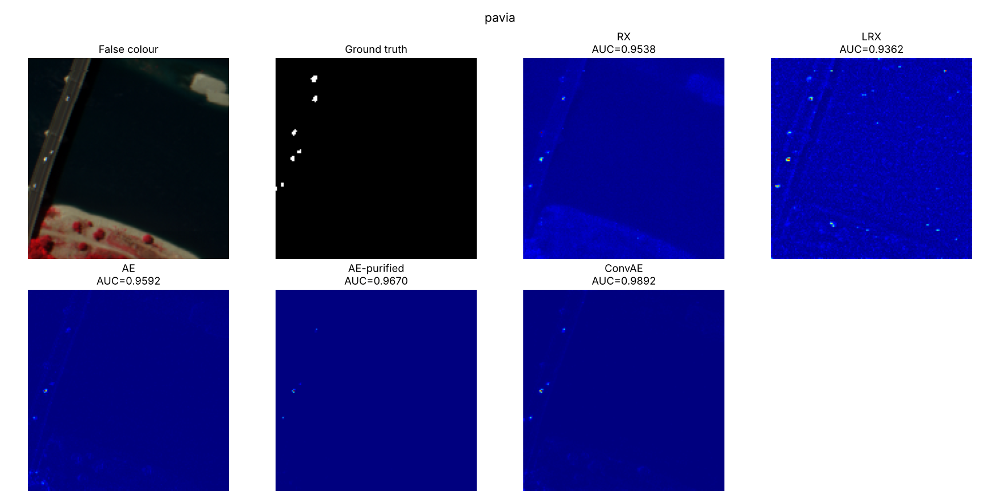
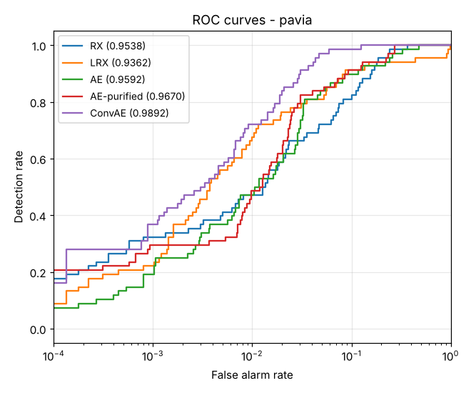
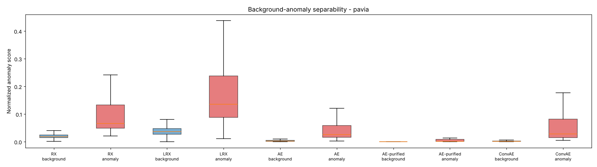
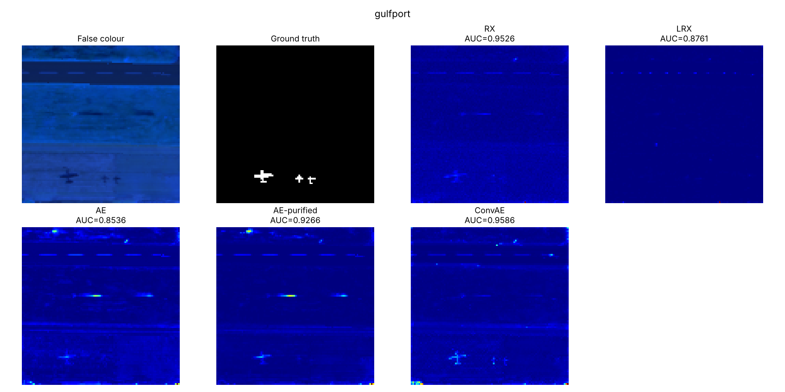

# Deep Learning-Based Hyperspectral Anomaly Detection

A comparative study of classical and deep learning methods. Final Year Project (BS Computer Science), University of Agriculture, Faisalabad.

**Status:** work in progress. Classical baselines and three deep learning models are implemented and evaluated on six benchmark scenes. Low-rank / tensor-based deep models are under development.

## Overview

Hyperspectral images record hundreds of narrow spectral bands for every pixel, so each material has its own spectral signature. **Hyperspectral anomaly detection (HAD)** aims to find pixels whose spectra differ from the surrounding background (e.g. aircraft on an airport, ships near a coast) **without any prior information about the targets** (fully unsupervised).

## Methods

| Method | Type | Idea |
|---|---|---|
| **RX** | Classical, global | Mahalanobis distance of each pixel from the image-wide mean and covariance |
| **LRX** | Classical, local | Dual-window RX: background statistics from a ring around each pixel (guard window excludes the target); PCA for a stable covariance |
| **AE** | Deep, spectral | Fully connected autoencoder; anomaly score = reconstruction error |
| **AE-purified** | Deep, spectral | Two-stage training: remove the 5% highest-error pixels (likely anomalies) and retrain on the purified background |
| **ConvAE** | Deep, spectral-spatial | Convolutional autoencoder on the whole image (bands as channels), using each pixel's spatial neighbourhood |

## Results (AUC, higher is better)

| Dataset | RX | LRX | AE | AE-purified | ConvAE |
|---|---|---|---|---|---|
| gulfport | 0.9526 | 0.8761 | 0.8536 | 0.9266 | **0.9586** |
| los-angeles-1 | 0.8221 | **0.9511** | 0.8053 | 0.8273 | 0.8152 |
| los-angeles-2 | 0.8404 | 0.8830 | 0.8756 | **0.9127** | 0.8697 |
| texas-goast | **0.9907** | 0.9838 | 0.9801 | 0.9856 | 0.9782 |
| cat-island | 0.9807 | 0.9524 | **0.9830** | 0.9431 | 0.9571 |
| pavia | 0.9538 | 0.9362 | 0.9592 | 0.9670 | **0.9892** |
| **Average** | 0.9234 | 0.9304 | 0.9094 | 0.9271 | 0.9280 |

**Observations so far**

- No single method wins on every scene: local methods (LRX) help where the background is heterogeneous (Los Angeles-1), while global RX is already strong on simple scenes (Texas Coast).
- **Background purification** improves the plain autoencoder on 4 of 6 scenes (average 0.9094 → 0.9271), confirming that anomalies contaminate the training data of a plain AE.
- The **spectral-spatial ConvAE** gives the best results on Gulfport and Pavia, showing the value of spatial context.
- These gaps motivate the next step: combining background purification, spatial context and low-rank priors in one model.

### Example: Pavia



<p float="left">
  
  
</p>

### Example: Gulfport (airport)



Detection maps, ROC curves and box plots for all six scenes are in [`results/`](results/).

## Project structure

```
├── main.py                  # runs all methods on all datasets, saves figures + AUC table
├── src/
│   ├── rx_detector.py       # global RX and dual-window local RX
│   ├── autoencoder.py       # spectral AE and background-purified AE (PyTorch)
│   ├── conv_autoencoder.py  # spectral-spatial convolutional AE (PyTorch)
│   └── utils.py             # data loading, AUC/ROC, detection maps, box plots
├── notebooks/
│   └── demo_colab.ipynb     # run everything in Google Colab
├── results/                 # figures and auc_table.md
└── requirements.txt
```

## How to run

```bash
pip install -r requirements.txt
python main.py                                  # all methods, all datasets
python main.py --datasets pavia --methods RX ConvAE
```

Datasets are downloaded automatically into `data/`. A GPU is used if available; on CPU the full run takes a few minutes.

Or open `notebooks/demo_colab.ipynb` in Google Colab.

## Roadmap

- [x] Data loading, normalization and visualization
- [x] RX and local (dual-window) RX baselines
- [x] Evaluation: AUC, ROC (log scale), background-anomaly box plots
- [x] Spectral autoencoder
- [x] Background-purified autoencoder
- [x] Spectral-spatial convolutional autoencoder
- [ ] Low-rank / tensor-based deep model (deep unfolding)
- [ ] Hyperparameter study (latent size, purification ratio, window sizes)
- [ ] Additional scenes (ABU Beach/Urban, San Diego, HYDICE)
- [ ] Interactive demo app

## Datasets

Benchmark scenes from the public Airport-Beach-Urban (ABU) collection (Kang et al., Hunan University) and the Pavia Centre scene, in the `.mat` format distributed with the [GT-HAD](https://github.com/jeline0110/GT-HAD) repository.

| Scene | Size | Anomalies |
|---|---|---|
| Gulfport | 100 × 100 × 191 | aircraft |
| Los Angeles-1, -2 | 100 × 100 × 205 | aircraft / buildings |
| Texas Coast | 100 × 100 × 204 | buildings |
| Cat Island | 150 × 150 × 188 | ship |
| Pavia Centre | 150 × 150 × 102 | vehicles on a bridge |

## References

1. I. S. Reed and X. Yu, "Adaptive multiple-band CFAR detection of an optical pattern with unknown spectral distribution," *IEEE Trans. Acoustics, Speech, and Signal Processing*, 1990.
2. X. Kang, X. Zhang, S. Li, K. Li, J. Li, and J. A. Benediktsson, "Hyperspectral anomaly detection with attribute and edge-preserving filters," *IEEE Trans. Geoscience and Remote Sensing*, 2017.
3. J. Lian, L. Wang, H. Sun, and H. Huang, "GT-HAD: Gated Transformer for Hyperspectral Anomaly Detection," *IEEE Trans. Neural Networks and Learning Systems*, 2024.

## Author

Areeba Riaz, [GitHub](https://github.com/AreebaRiaz123)
